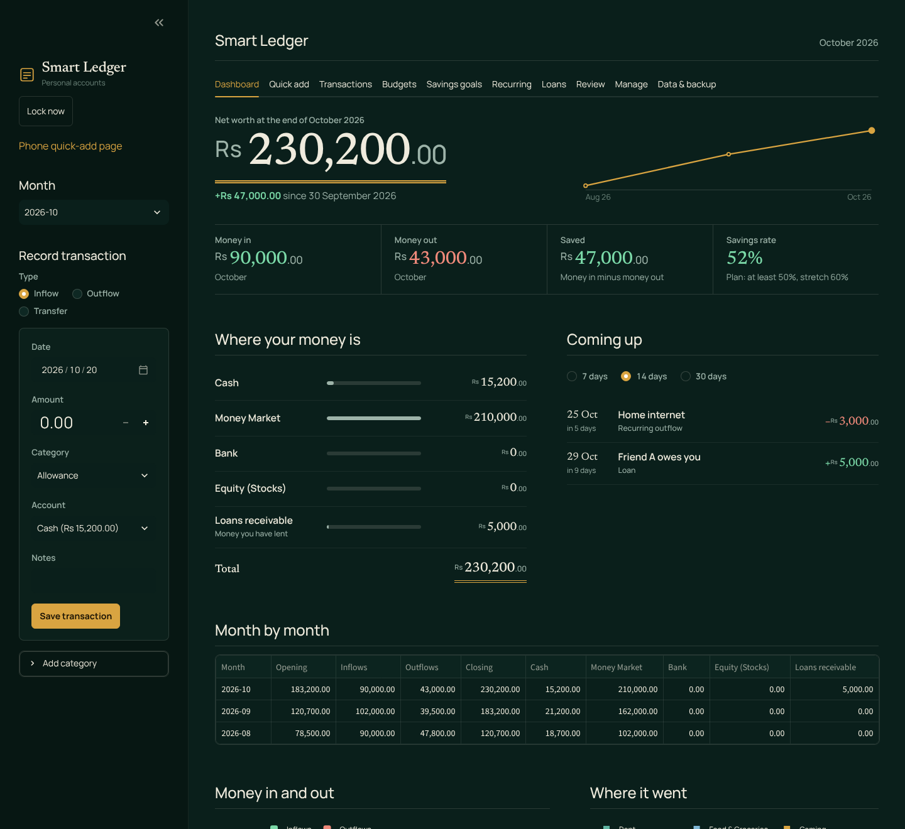
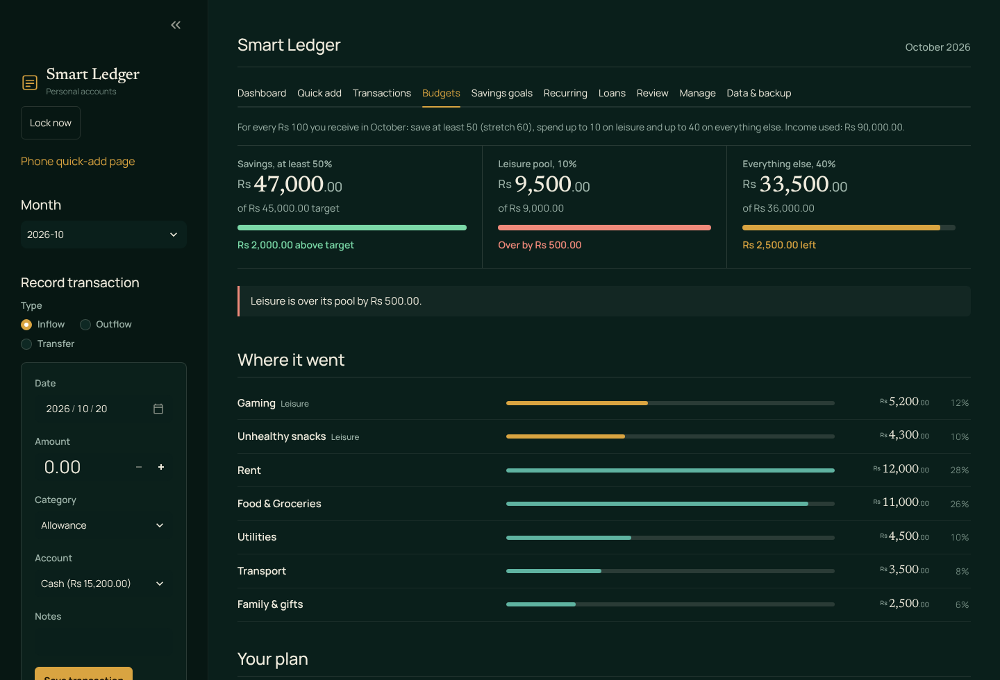
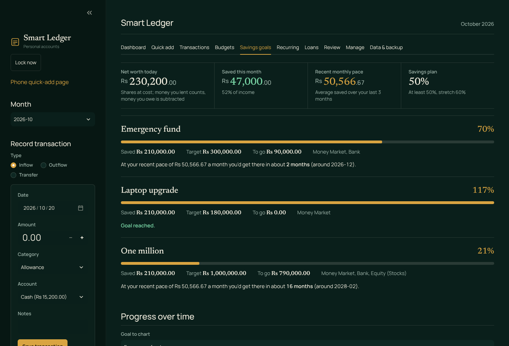
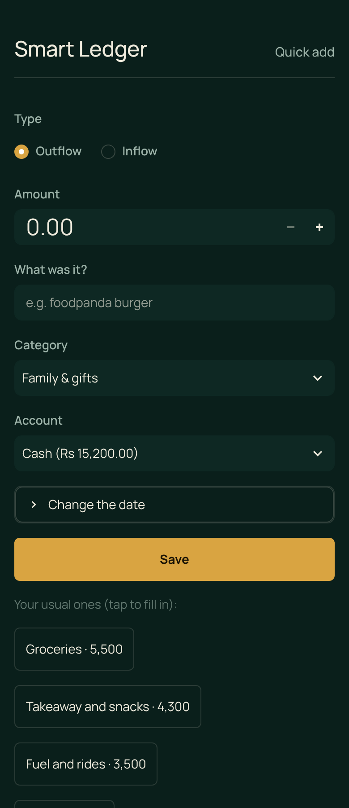
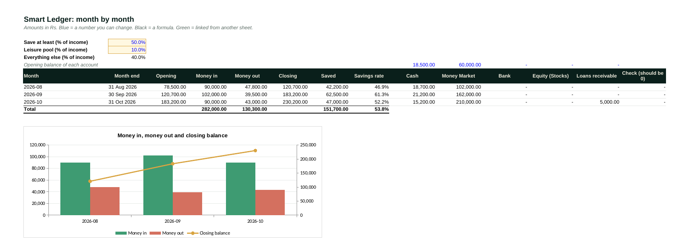

# Smart Ledger

A private, local-first personal finance ledger: track money in and out, move money between accounts, plan a budget, follow savings goals and export everything to Excel. Built with Python, Streamlit, SQLite, pandas and Plotly. All screenshots below use **invented data**.



## What it does

- **Ledger with transfers.** Inflows, outflows and transfers between your own accounts (cash, savings, investments). A transfer is neither income nor spending, so savings rates and budgets stay honest. Loans you lend or borrow are tracked on two bookkeeping accounts (receivable and payable) for the same reason.
- **Budget pools.** One simple rule: save at least a set share of income, share one leisure pool across all leisure categories, and let everything else share the remainder.
- **Savings goals and a what-if planner.** Progress by account, the monthly amount needed for a deadline, and a compound-growth planner (assumed return, yearly raise, inflation).
- **Recurring entries, loans and IOUs, balance check, monthly review.** The balance check compares the ledger with the real money you count and can book the gap.
- **Excel export.** A formatted workbook whose totals are live `SUMIFS` / `INDEX-MATCH` formulas, with a check column that shows the accounts add up to the closing balance.
- **Phone quick-add page, PIN lock and automatic backups.** Smart category suggestions come from editable keyword rules plus your own history. Nothing leaves your computer.

| Budget pools | Savings goals |
|---|---|
|  |  |

| Phone quick-add | Excel export |
|---|---|
|  |  |

## Try it with the demo data

```bash
pip install -r requirements.txt
python demo_data.py        # creates ledger.db with invented data (PIN: demo1234)
streamlit run app.py
```

On Windows you can use `python -m streamlit run app.py`. Without `demo_data.py`, the first start creates an empty ledger and asks you to set your own PIN.

## Using it for real

Run `streamlit run app.py` in a folder without `ledger.db`, set a PIN, and start recording. Your data lives in `ledger.db` next to the code; `.gitignore` keeps it (and backups and exports) out of Git. Set the currency label at the top of `app.py` (`CURRENCY`). The **Data & backup** tab covers backups, restore, the Excel export and the phone link.

## Design notes

- **Data model.** SQLite tables for accounts, categories, transactions (type is Inflow, Outflow or Transfer), goals, loans, recurring rules and settings. `sample_queries.sql` has five queries you can run to explore it.
- **Why transfers matter.** Moving money from cash to savings must not look like spending. A balance is: opening balance + inflows - outflows - transfers out + transfers in.
- **Reconciliation.** The Excel workbook recomputes each month's closing balance from the Transactions sheet and compares it with the sum of the account balances.
- **PIN lock.** The PIN is stored as a salted scrypt hash, wrong guesses trigger a timed lock-out, and the app locks itself after 30 minutes idle. It is meant for a home network, not as a substitute for operating-system security.
- **Look and feel.** `theme.py` holds the visual identity (a statement-style ledger layout with serif figures) and the chart styling.

## Limitations

- Single user, no bank sync, and amounts are entered by hand.
- No automated test suite yet. The export formulas were checked by recalculating the workbook in LibreOffice and comparing every formula with the app's figures.
- The local web page is served over plain HTTP, so use the phone page only on a home network you trust.
- Not financial, tax or legal advice.

## Roadmap

Shares and investments tracker, tax-year summary, statement import, automated tests.

## How it was built

Built with AI coding assistants (Gemini and Claude). [Author:Karam Ul Wazah. I provided prompts to gemini and claude to assist me in building this exepnse tracker app. I tested another version of this app using my own financial data and figures and told AI to fix the bugs I found.]

## Licence

MIT. See `LICENSE`.
